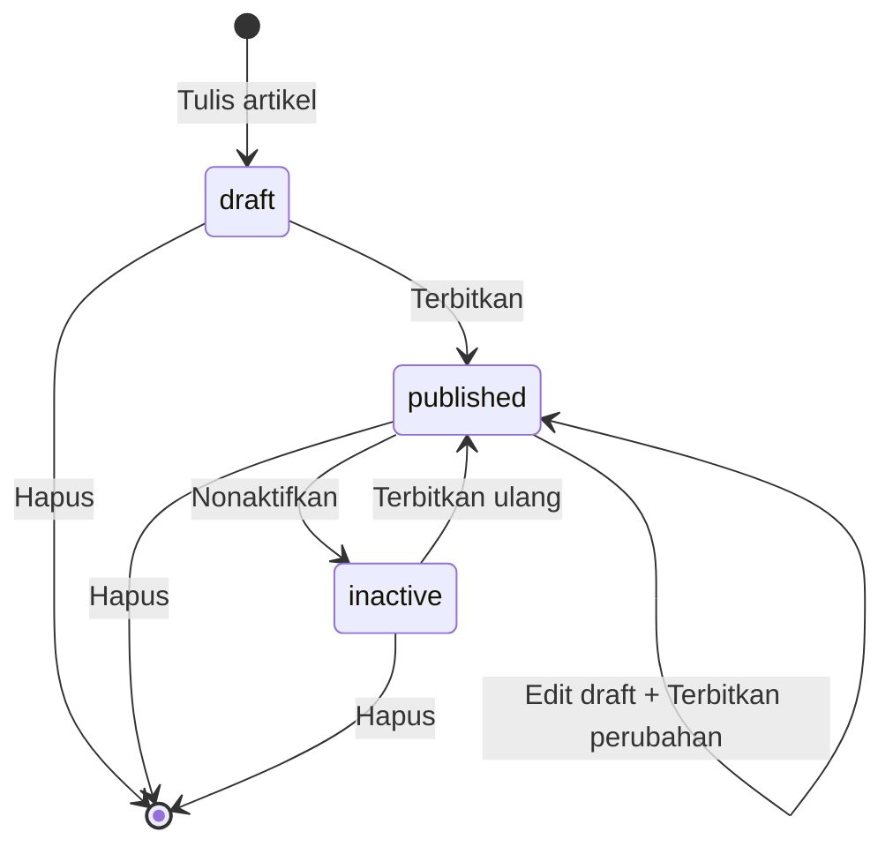

# PRD — Website Personal Branding & CMS Sony Christanto

| | |
|---|---|
| Produk | Website personal branding + blog + dashboard CMS |
| Klien | Sony Christanto, SE., M.Si — Anggota DPRD Kota Batam |
| Domain | `sonychristanto.com` |
| Tim | Bidtech (PM, developer, designer) |
| Status | Draf v1 — 6 November 2026 |
| Metode | Agile, sprint 1 minggu |

> **Catatan ejaan:** nama yang benar adalah **Sony Christanto** (tanpa "i"), sesuai CV, domain, dan akun media sosial. Konsistensi nama sangat penting untuk SEO dan entity recognition.

---

## 1. Latar belakang

Klien belum mengisi kuisioner kebutuhan. Tim memutuskan memakai pendekatan agile: membangun dari materi yang sudah ada (CV resmi klien), lalu melengkapi konten per sprint begitu materi baru masuk. Prototype tampilan sprint 1 sudah dibuat dari isi CV.

Semua fakta biografis di situs **wajib** berasal dari klien (CV atau konfirmasi tertulis). Tidak ada klaim, angka, atau kutipan karangan. Bagian yang belum ada datanya ditampilkan sebagai "Segera hadir" atau disembunyikan.

## 2. Tujuan

1. **Identitas resmi online**: satu sumber rujukan yang akurat tentang Sony Christanto bagi publik, media, dan mesin pencari.
2. **Kanal gagasan & kegiatan**: klien (atau timnya) bisa menerbitkan *Perspektif Sony* dan *Agenda Sony* sendiri tanpa developer.
3. **Mudah ditemukan**: tampil baik di Google (SEO), di kotak jawaban (AEO), dan di asisten AI seperti ChatGPT, Claude, dan Perplexity (GEO).
4. **Cepat & ringan**: hampir semua halaman statis (SSG); halaman blog di-cache (ISR).

### Indikator keberhasilan (usulan, disepakati dengan klien)

- Pencarian "Sony Christanto" → situs ini di posisi 1 dalam 4–8 minggu setelah go-live.
- Lighthouse mobile ≥ 90 untuk Performance, SEO, Accessibility, dan Best Practices di halaman publik.
- LCP < 2,5 s, CLS < 0,1 (Core Web Vitals, data lapangan dari GA4/Search Console).
- Tim klien menerbitkan artikel tanpa bantuan developer (target ≥ 2 artikel/bulan).

## 3. Pengguna

| Persona | Kebutuhan |
|---|---|
| **Warga / konstituen Kota Batam** | Mengenal profil, membaca pandangan, tahu kegiatan, menghubungi kantor. |
| **Media & jurnalis** | Biografi akurat, foto resmi, rekam jejak organisasi, kontak. |
| **Mitra organisasi / lembaga** | Kiprah organisasi, karya tulis, penghargaan. |
| **Admin (tim klien)** | Menulis, menyimpan draft, menerbitkan, menonaktifkan, menghapus artikel; mengelola akun admin. |

## 4. Lingkup

**Termasuk (v1):** 9 modul di bawah, SEO/AEO/GEO, GTM, CI/CD ke VPS.

**Tidak termasuk (v1), masuk backlog:** pencarian artikel, form aspirasi, newsletter, multi-bahasa, tag artikel, jadwal terbit otomatis, riwayat revisi, media library, pengelolaan modul statis lewat dashboard, komentar publik.

## 5. Peta sprint (usulan)

Sprint 1 minggu, mengikuti alur Bidtech (Plan → Design → Development → Testing → Deployment).

| Sprint | Fokus | Hasil |
|---|---|---|
| 0 (selesai) | Prototype tampilan dari CV | Prototype beranda |
| 1 | Setup repo, CI/CD, auth, akun admin | Scaffold ini, deploy staging |
| 2 | Modul Artikel (dashboard + blog publik) | Admin bisa menerbitkan artikel |
| 3 | Landing page final, Biografi, Kontak, Organisasi | Konten inti dari CV + materi klien |
| 4 | Penghargaan, Karya Tulis, Galeri | Tergantung materi klien |
| 5 | QA, SEO audit, Search Console, serah terima | Go-live `sonychristanto.com` |

Scaffold awal sudah mencakup kerangka **semua** modul. Sprint berikutnya berisi penyempurnaan UI, pengisian konten, dan pengujian.

---

## 6. Modul

Status: ✅ ada di scaffold · 🟡 kerangka ada, menunggu konten/keputusan · ⬜ belum.

### Modul 1 — Landing page (`/`) 🟡

**Render:** ISR (bukan SSG), karena menampilkan artikel terbaru. Cache di-purge otomatis saat artikel terbit.

#### Brainstorming: isi landing page

Prinsip: landing page menjawab tiga pertanyaan pengunjung dalam 10 detik, yaitu **siapa dia**, **apa yang ia perjuangkan**, dan **apa yang sedang ia kerjakan**. Lalu memberi jalan untuk menghubungi.

| # | Section | Isi | Sumber data | Prioritas | Status |
|---|---|---|---|---|---|
| 1 | **Hero** | Foto resmi, nama + gelar, jabatan, 1 kalimat positioning, CTA "Kenali lebih dekat" dan "Hubungi" | CV + **tagline dari klien** | MVP | ✅ (tagline masih draf) |
| 2 | **Sekilas angka** | 3–4 angka faktual (tahun mulai berkarier, jumlah organisasi, tahun menjabat) | CV | MVP | ✅ |
| 3 | **Perspektif Sony terbaru** | 3 artikel kategori Perspektif | Dashboard | MVP | ✅ |
| 4 | **Agenda Sony terbaru** | 3 artikel kategori Agenda | Dashboard | MVP | ✅ |
| 5 | **Kiprah** | Organisasi yang sedang dipimpin | CV | MVP | ✅ |
| 6 | **Fokus / prioritas perjuangan** | 3–4 isu utama (mis. pendidikan, olahraga, dunia usaha), masing-masing 1 paragraf + tautan ke Perspektif terkait | **Klien** | Tinggi | ⬜ menunggu materi |
| 7 | **Kutipan / pesan pribadi** | 1 kutipan pendek dari klien dengan foto | **Klien** | Sedang | ⬜ |
| 8 | **Penghargaan unggulan** | 2–3 penghargaan terpenting | Modul 4 | Sedang | ⬜ tunggu data |
| 9 | **Cuplikan galeri** | 4–6 foto kegiatan, tautan ke Galeri | Modul 7 | Sedang | ⬜ tunggu foto |
| 10 | **CTA aspirasi** | Ajakan menghubungi kantor (nanti: form aspirasi) | CV | MVP | ✅ |

**Rekomendasi PM untuk v1:** section 1–5 dan 10 (sudah ada), ditambah **section 6 (Fokus perjuangan)** begitu klien memberi materi, karena itu pembeda terbesar dari CV biasa. Section 7–9 masuk ketika datanya ada.

**Pertanyaan untuk klien (landing):**
1. Satu kalimat yang paling menggambarkan Bapak? (untuk hero)
2. Tiga isu yang paling ingin Bapak perjuangkan di DPRD?
3. Apakah ada kutipan/moto pribadi yang boleh ditampilkan?
4. Foto resmi resolusi tinggi (min. 1200 px) dan 10–20 foto kegiatan.

**Kriteria penerimaan:**
- Hero, nama, dan jabatan terlihat tanpa scroll di layar 390×844.
- Bila API artikel gagal, halaman tetap tampil (section artikel menampilkan "Segera hadir").
- Artikel baru muncul di landing ≤ 5 detik setelah diterbitkan.

### Modul 2 — Biografi (`/biografi`) ✅

Ringkasan bio, karier (timeline), pendidikan, keahlian, hobi, dan **Tanya-jawab (FAQ)** untuk AEO. JSON-LD: `ProfilePage`, `Person`, `FAQPage`. SSG.

- Data: `frontend/app/data/biography.ts`.
- **Tanggal lahir** (16 Desember 1974, dari CV) ditampilkan di Biografi, FAQ, dan JSON-LD `birthDate`. **Agama tidak dipublikasikan** (K-2). Satu saklar: `site.showBirthDate`.
- Paragraf bio saat ini adalah **draf rangkuman CV**, perlu persetujuan klien.

### Modul 3 — Artikel / Blog ✅

**Publik:** `/blog` (semua, paginasi 9/halaman), `/blog/kategori/{perspektif-sony|agenda-sony}`, `/blog/{slug}`. ISR, di-purge saat terbit, nonaktif, atau hapus.

**Kategori:**
- **Perspektif Sony**: pendapat atau pandangan Sony atas sebuah isu, masalah, atau ide. JSON-LD `BlogPosting`.
- **Agenda Sony**: catatan kegiatan (pertemuan, kegiatan sosial, dsb.). JSON-LD `NewsArticle`.

**Dashboard (`/dashboard/artikel`):**

| Kebutuhan | Perilaku |
|---|---|
| Tulis & simpan draft | "Tulis artikel" langsung membuat draft kosong lalu membuka editor. |
| **Autosave** | Setiap perubahan disimpan otomatis 1,5 detik setelah berhenti mengetik. Status tampil: *Menyimpan… / Draft tersimpan HH.MM / Gagal*. Peringatan saat menutup tab dengan perubahan belum tersimpan. |
| Publikasikan | Validasi ketat: judul ≥ 5 karakter, kategori wajib, isi ≥ 50 karakter, alt text wajib bila ada banner. Slug dibuat otomatis dari judul (atau diisi manual sebelum terbit pertama). |
| Edit artikel terbit | Perubahan hanya masuk ke **draft**; halaman publik tidak berubah sampai "Terbitkan perubahan". Label "Ada perubahan belum terbit" tampil. Tersedia "Buang perubahan" untuk kembali ke versi terbit. |
| Nonaktifkan | Artikel hilang dari publik (404) tetapi data tetap ada; bisa diterbitkan ulang. |
| Hapus | Permanen (artikel + draft). Gambar di storage tetap tercatat di tabel `media` untuk dibersihkan nanti. |
| Slug | **Dikunci setelah terbit pertama** supaya tautan dan SEO tidak rusak. |
| Konflik | Dua tab/admin mengedit draft yang sama: penyimpanan yang basi ditolak (409) dan pengguna diminta memuat ulang. Tidak ada overwrite diam-diam. |
| Banner | Upload gambar → WebP ≤ 1920×1080 q80. Dipakai juga sebagai `og:image`. |
| Ringkasan | Opsional; bila kosong diambil otomatis dari 160 karakter pertama isi. Dipakai sebagai meta description. |

**Editor (BlockNote, gaya Notion):** paragraf, heading (H1–H3 di editor → H2–H4 di halaman), kutipan, bullet/numbered/checklist, divider, **gambar** (upload, caption), **kolom maksimal 2**. Tabel, video, audio, file, dan kode **sengaja tidak diaktifkan** (lihat backlog). Batas 2 kolom dijaga di dua tempat: menu slash hanya menyediakan "Two Columns", dan backend menolak dokumen dengan >2 kolom.

### Modul 4 — Penghargaan (`/penghargaan`, `/penghargaan/{slug}`) 🟡

Statis (SSG). Daftar (judul, pemberi, tahun, ringkasan, gambar) + halaman detail (cerita, foto). Data: `frontend/app/data/awards.ts`, saat ini **kosong**, jadi halaman menampilkan "Segera hadir". Butuh data dari klien.

### Modul 5 — Organisasi (`/organisasi`, `/organisasi/{slug}`) ✅

Statis. 10 organisasi + 4 riwayat kepartaian dari CV, dikelompokkan *periode berjalan / sebelumnya / kepartaian*. Detail per organisasi: peran, periode, deskripsi, **kontribusi** (menunggu materi klien), logo. JSON-LD `OrganizationRole`. Data: `frontend/app/data/organizations.ts`.

### Modul 6 — Karya Tulis (`/karya-tulis`, `/karya-tulis/{slug}`) 🟡

Statis. Fokus artikel ilmiah. Detail: abstrak, kata kunci, DOI/tautan, PDF (bila klien mengizinkan). Meta `citation_*` untuk Google Scholar dan JSON-LD `ScholarlyArticle`. Data: `frontend/app/data/publications.ts`, **kosong**.

### Modul 7 — Galeri (`/galeri`) 🟡

Statis. Bento grid (ukuran tile `sm/wide/tall/lg`), klik untuk tampilan penuh (lightbox, navigasi panah/keyboard, Esc untuk tutup). JSON-LD `ImageGallery`. Foto dioptimasi dengan `npm run images:optimize` (WebP ≤ 1920×1080 q80). Data: `frontend/app/data/gallery.ts`, **kosong**.

### Modul 8 — Kontak (`/kontak`) ✅

Statis. Email, WhatsApp, Instagram, Facebook (URL menunggu klien), alamat kantor + tautan Google Maps (disembunyikan sementara lewat `site.contact.showOffice = false` di `frontend/app/data/site.ts`; berlaku untuk footer, beranda, /kontak, JSON-LD, llms-full.txt, dan FAQ). JSON-LD `ContactPage`.

### Modul 9 — Autentikasi & akun ✅

| Fitur | Aturan |
|---|---|
| Login / logout | Email + password. Sesi JWT di **cookie httpOnly** (bukan localStorage), berlaku 12 jam. Rate limit login: 5 percobaan, lalu 1 per 12 detik per IP. |
| Satu peran: admin | Semua admin punya hak akses yang sama. |
| **Superadmin** | Akun **pertama** di sistem (`is_superadmin = true`), dibuat otomatis dari env `SEED_ADMIN_*` saat tabel admin kosong. Maksimal satu superadmin (dijaga unique index). |
| Kelola akun (`/dashboard/akun`) | Tambah admin, edit nama/email, nonaktifkan/aktifkan, ganti password admin lain, hapus admin. |
| Proteksi | Superadmin **tidak bisa** diedit, direset, dinonaktifkan, atau dihapus dari halaman kelola akun. Admin tidak bisa menonaktifkan atau menghapus dirinya sendiri. |
| Efek langsung | Menonaktifkan akun atau mereset password langsung mengakhiri sesi akun tersebut. |
| Pengaturan (`/dashboard/pengaturan`) | Ubah nama, email, foto profil; ganti password (wajib password lama; sesi di perangkat lain berakhir). |
| Hapus admin | Artikel yang ditulisnya tetap ada (penulis dikosongkan). |

---

## 7. Kebutuhan non-fungsional

### 7.1 SEO, AEO, GEO

| Item | Implementasi |
|---|---|
| `sitemap.xml` | Halaman statis + semua artikel terbit, dengan `lastmod`. ISR. |
| `robots.txt` | Izinkan semua; blokir `/dashboard`, `/api/`, `/_internal/`; crawler AI diizinkan eksplisit (K-6). |
| `llms.txt` | Peta situs ringkas dalam Markdown untuk LLM (llmstxt.org). |
| `llms-full.txt` | Seluruh teks publik (bio, organisasi, isi artikel) dalam satu file. |
| `/.well-known/security.txt` | RFC 9116, kontak keamanan. |
| `feed.xml` | RSS 2.0, 30 artikel terbaru. |
| Meta | Title template, description, canonical, Open Graph, Twitter card per halaman. |
| JSON-LD | `WebSite` + `Person` (entitas inti, `@id` konsisten) di semua halaman, ditambah `BreadcrumbList`, `ProfilePage`, `FAQPage`, `BlogPosting`/`NewsArticle`, `ScholarlyArticle`, `ImageGallery`, `ContactPage`. |
| AEO | FAQ faktual di Biografi, heading yang menjawab pertanyaan, ringkasan di awal artikel. |
| GEO | Entitas konsisten (nama, jabatan, `sameAs` ke media sosial), llms.txt/llms-full.txt, tanggal terbit/perbarui jelas, sumber fakta = CV. |
| Teknis | HTML semantik, satu `<h1>` per halaman, `lang="id"`, gambar ber-`alt`, URL bersih berbahasa Indonesia. |
| Analytics | Google Tag Manager `GTM-5FC5K5DH` (env `NUXT_PUBLIC_GTM_ID`), hanya di halaman publik, tidak di dashboard. Event `virtual_page_view` untuk navigasi SPA. |

### 7.2 Rendering

| Halaman | Strategi |
|---|---|
| Biografi, Organisasi (+detail), Penghargaan (+detail), Karya Tulis (+detail), Galeri, Kontak, robots.txt, security.txt | **SSG** (prerender saat build) |
| `/`, `/blog`, `/blog/**`, sitemap, feed, llms | **ISR** (cache 10 menit, purge otomatis saat terbit) |
| `/dashboard/**` | SPA, `noindex`, `no-store` |

### 7.3 Gambar

Semua upload dashboard: auto-rotate EXIF, **resize maksimal 1920×1080 (tidak di-upscale)**, **konversi WebP kualitas 80**, metadata EXIF/GPS dibuang. Maks. 10 MB per file; JPG/PNG/WebP/GIF. Avatar dipotong 512×512. Gambar statis website dioptimasi dengan skrip yang sama aturannya.

### 7.4 Keamanan

bcrypt cost 12; JWT HS256 dengan versi token (revoke instan); cookie `HttpOnly; Secure; SameSite=Lax`; rate limit login dan upload; validasi isi editor di backend (tipe blok whitelist, gambar hanya dari `/media/`); tautan `javascript:` dibuang saat render; bucket storage **privat** (gambar dilayani lewat backend); header keamanan; container non-root; secrets hanya di GitHub Secrets.

### 7.5 Aksesibilitas

Kontras teks ≥ 4.5:1, target sentuh ≥ 44 px, navigasi keyboard, skip link, label pada semua input, `alt` wajib untuk banner, dialog native (`<dialog>`).

### 7.6 Infrastruktur

Docker di VPS bersama (Hostinger KVM, Ubuntu 24.04), nginx di host sebagai reverse proxy, Cloudflare untuk DNS + cache, RustFS sebagai service di compose proyek ini (volume sendiri, terpisah dari RustFS lain di VPS), image di GHCR, deploy via GitHub Actions. Detail: `docs/architecture.md`.

---

## 8. Keputusan terbuka

| ID | Keputusan | Opsi | Rekomendasi PM/tech | Pemilik |
|---|---|---|---|---|
| **K-1** | **Lisensi fitur kolom editor.** `@blocknote/xl-multi-column` berlisensi **GPL-3.0 atau komersial** (BlockNote inti MPL-2.0). | (a) Beli lisensi BlockNote Business; (b) terima GPL-3.0 (konsultasikan legal: kode dashboard yang didistribusikan mungkin wajib dibuka); (c) buat blok 2-kolom sendiri; (d) hapus fitur kolom | Putuskan **sebelum go-live**. Saat ini terpasang untuk pengembangan. | PM + manajemen |
| K-2 | Tampilkan tanggal lahir & agama? | Tampilkan / sembunyikan | **Diputuskan 7 Nov 2026 (PM):** tanggal lahir tampil; agama tidak. Mohon konfirmasi final dari klien | Klien |
| K-3 | Kategori artikel dikelola di kode atau dashboard? | Kode (sekarang) / CRUD kategori | Kode, karena hanya 2 kategori. Tambah CRUD bila > 4 | PM |
| K-4 | Riwayat kepartaian (KIRA, Nasdem, PSI) | Semua / sebagian / hanya aktif | Tanyakan klien | Klien |
| K-5 | Isi landing page final | Lihat Modul 1 | Section 1–6 + 10 | PM + klien |
| K-6 | Izinkan crawler AI (GPTBot, ClaudeBot, dll.) | Izinkan / blokir | Izinkan (mendukung GEO) | Klien |
| K-7 | Hak tambahan superadmin selain terlindungi? | Tidak ada / mis. hanya superadmin yang boleh hapus admin | Tidak ada (sesuai brief) | PM |
| K-8 | Routing nginx `/api/` & `/media/` | Langsung ke backend / lewat frontend | Langsung ke backend (lebih efisien), keduanya didukung | DevOps |
| K-10 | Typo "Kontap Pendidikan" (KADIN) & jabatan di Badan Kerjasama Antar Gereja | — | Konfirmasi klien | Klien |
| K-11 | URL Facebook resmi | — | Minta klien | Klien |
| K-13 | Artikel blog dwibahasa? | Hanya Indonesia (sekarang) / kolom judul+isi EN di dashboard | Indonesia saja; `/en/blog` tampil dengan UI Inggris, `noindex` + canonical ke `/id`. Bila klien ingin EN, perlu kolom terjemahan di backend & editor (sprint berikut) | PM + klien |
| K-14 | Foto & logo dari desain | File asli sudah masuk repo (7 Nov 2026). Sisa: izin pemakaian logo organisasi & partai, dan sumber/kredit foto gedung pendidikan | Konfirmasi sebelum go-live | Klien |
| K-15 | Akun media sosial | — | **Selesai 7 Nov 2026:** IG @christantosony, LinkedIn, Facebook (halaman 100066718021962), TikTok @sony.christanto — di `site.social` | — |
| K-12 | Email `security.txt` | — | **Selesai:** `cs@bidtech.co.id` | — |

## 9. Risiko

| Risiko | Dampak | Mitigasi |
|---|---|---|
| Materi klien lambat | Modul statis kosong | "Segera hadir" yang rapi; sprint fleksibel (agile) |
| Lisensi GPL fitur kolom | Hukum/komersial | K-1 sebelum go-live |
| VPS bersama (RAM 4 GB) | Contention antar project | `mem_limit` per container, image kecil (backend ~13 MB) |
| Backup satu server | Kehilangan data | Backup harian `pg_dump` + volume RustFS (`sonychristanto_rustfs_data`) ke luar VPS (wajib sebelum go-live) |
| Cache Cloudflare menahan HTML lama | Artikel baru telat muncul | Purge via API (opsional) atau bypass HTML `/blog` (lihat ops) |

## 10. Backlog (setelah v1)

Form aspirasi (dengan anti-spam), pencarian artikel, tag, jadwal terbit, riwayat revisi + pratinjau draft, media library + pembersihan gambar yatim, tabel/video di editor, CRUD modul statis lewat dashboard, newsletter, versi Bahasa Inggris, migrasi skema versioned (goose), backup otomatis off-site, monitoring uptime.
