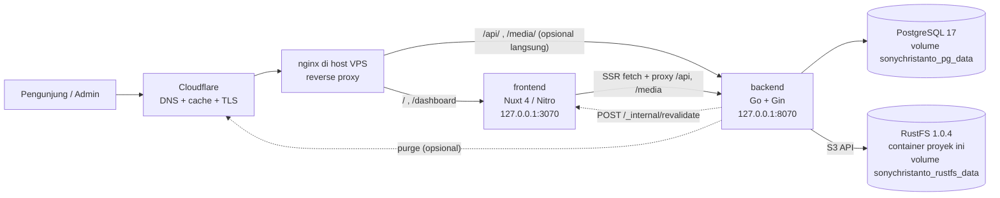
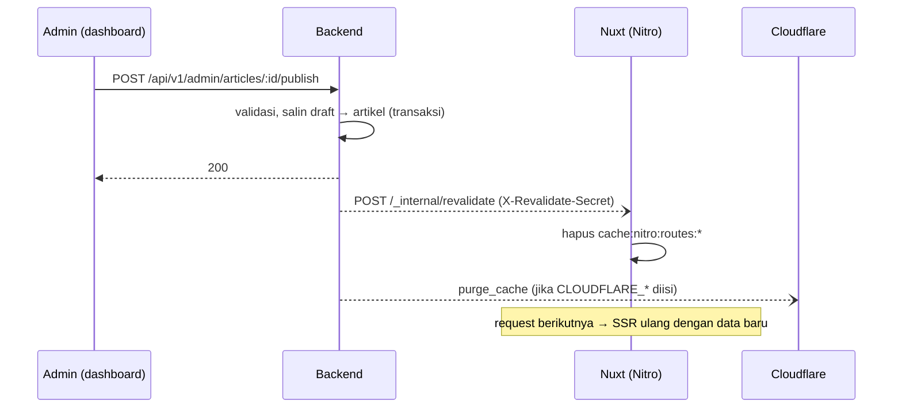
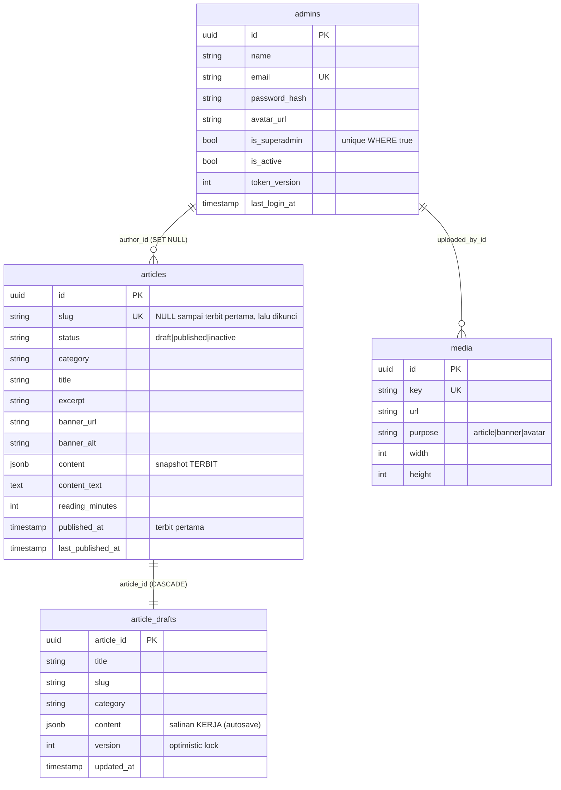
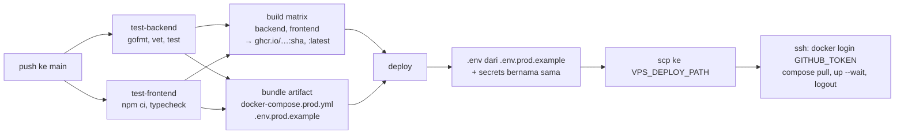

# Arsitektur — sonychristanto.com

## 1. Gambaran



| Komponen | Teknologi | Catatan |
|---|---|---|
| Frontend | Nuxt 4 (Vue 3, Nitro node-server), Tailwind CSS v4, @nuxt/fonts | Website publik + dashboard SPA dalam satu app |
| Editor | BlockNote 0.57 (React) dipasang di komponen Vue client-only | `frontend/app/editor/blocknote.ts` |
| Backend | Go 1.26, Gin, GORM, golang-jwt v5, bcrypt, minio-go (S3), imaging + gen2brain/webp | Binary statis di image distroless (~13 MB) |
| Database | PostgreSQL 17 | Container khusus project ini |
| Object storage | RustFS 1.0.4 (S3-compatible) | Container milik proyek ini (dev & prod), bucket privat `sonychristanto` |
| CI/CD | GitHub Actions → GHCR → SSH ke VPS | `.github/workflows/sonychristanto.yml` |
| Edge | Cloudflare (DNS, proxy, cache) + nginx host | Konfigurasi di luar repo (bundle ops) |

## 2. Struktur repo

```
.
├── .github/workflows/sonychristanto.yml   # test → build → GHCR → deploy
├── backend/
│   ├── cmd/server/main.go                 # entrypoint (+ subcommand `healthcheck`)
│   ├── internal/
│   │   ├── auth/         # bcrypt, JWT
│   │   ├── config/       # env → Config (fail-fast di production)
│   │   ├── content/      # validasi dokumen BlockNote, plain text, reading time
│   │   ├── database/     # koneksi, AutoMigrate, seed superadmin
│   │   ├── handlers/     # HTTP handlers (auth, accounts, articles, media)
│   │   ├── imageproc/    # EXIF rotate → resize ≤1920×1080 → WebP q80
│   │   ├── middleware/   # RequireAuth, RateLimit, SecurityHeaders, Logger
│   │   ├── models/       # GORM models + kategori
│   │   ├── revalidate/   # purge ISR Nuxt + Cloudflare
│   │   ├── router/       # daftar route
│   │   ├── slug/         # slugify
│   │   └── storage/      # klien S3 (RustFS)
│   ├── scripts/smoke-test.sh              # uji E2E API (50 cek)
│   └── Dockerfile                          # target: dev | runtime
├── frontend/
│   ├── app/
│   │   ├── data/         # KONTEN STATIS: site, biography, organizations, awards, publications, gallery, routes
│   │   ├── pages/        # route publik + /dashboard
│   │   ├── components/   # site/, blog/, dashboard/, editor/
│   │   ├── editor/       # modul React BlockNote (bukan komponen Vue)
│   │   ├── composables/  # useAuth, useAdminApi, usePageSeo/useJsonLd
│   │   ├── utils/        # schema.org builders, format tanggal
│   │   ├── layouts/      # default (publik), dashboard
│   │   └── middleware/auth.ts
│   ├── server/
│   │   ├── routes/       # sitemap.xml, robots.txt, llms*.txt, feed.xml, .well-known/security.txt,
│   │   │                 # api/v1/** & media/** (proxy), _internal/revalidate
│   │   └── utils/backend.ts
│   ├── public/           # favicon, images/ (statis, sudah WebP)
│   ├── scripts/optimize-images.mjs
│   └── Dockerfile        # target: dev | runtime
├── docs/                 # PRD, architecture, API, DESIGN
├── docker-compose.yml        # dev: postgres + rustfs + backend (air) + frontend (nuxt dev)
└── docker-compose.prod.yml   # prod: postgres + rustfs + backend + frontend (image GHCR)
```

## 3. Rendering & cache

| Route | Mode | Cache |
|---|---|---|
| `/{id,en}/biografi`, `/{id,en}/organisasi`, `/{id,en}/organisasi/*`, `/{id,en}/penghargaan(/*)`, `/{id,en}/karya-tulis(/*)`, `/{id,en}/galeri`, `/{id,en}/kontak`, `/robots.txt`, `/.well-known/security.txt` | **SSG**: prerender saat `nuxt build` (di CI) | File statis |
| `/id`, `/en`, `/{id,en}/blog`, `/{id,en}/blog/kategori/*`, `/{id,en}/blog/*`, `/feed.xml`, `/llms.txt`, `/llms-full.txt` | **ISR**: SSR + `swr: 600` | Cache Nitro 10 menit, `s-maxage=600, stale-while-revalidate` |
| `/sitemap_index.xml`, `/__sitemap__/{id-ID,en-US}.xml` | `@nuxtjs/sitemap` (dinamis) | cache modul 10 menit, ikut dibersihkan revalidate |
| `/`, `/biografi`, `/blog/...` (tanpa prefix) | 301 → `/id/...` (`server/middleware/locale-redirect.ts`) | — |
| `/dashboard/**` | SPA (`ssr: false`) | `no-store`, `X-Robots-Tag: noindex` |
| `/_nuxt/**` | aset ber-hash | `max-age=31536000, immutable` |
| `/media/**` | stream dari bucket via backend | `max-age=31536000, immutable` (key = UUID, tidak pernah ditimpa) |

Daftar route SSG ada di **satu tempat**: `frontend/app/data/routes.ts` (tanpa prefix; `nuxt.config.ts` mengalikan dengan locale `id`, `en`). Dipakai `nuxt.config.ts` (prerender), sitemap, dan llms.txt. Menambah organisasi/penghargaan/karya tulis cukup mengedit file data, karena halaman detail ikut terbuat saat build berikutnya.

**Kenapa `/` ISR, bukan SSG:** beranda menampilkan artikel terbaru, sedangkan API tidak tersedia saat build di CI.

### Alur on-demand revalidation



Revalidate bersifat asinkron dan *best effort*. Bila gagal, halaman tetap diperbarui saat TTL 10 menit habis. Sudah diuji: artikel baru muncul di `/blog` dan `/` sesaat setelah terbit, dan halaman artikel langsung 404 setelah dinonaktifkan.

## 4. Data model



- **Dua salinan per artikel**: `articles` = versi publik, `article_drafts` = versi kerja. Autosave hanya menyentuh draft, dan publish menyalin draft ke artikel. Inilah yang membuat "edit tanpa mengubah halaman publik" sederhana dan aman.
- `has_unpublished_changes` = `draft.updated_at > articles.last_published_at`.
- Skema dibuat oleh GORM `AutoMigrate` saat backend start. Sebelum perubahan skema yang destruktif, pindah ke migrasi versioned (goose).

## 5. Autentikasi

- Login → JWT HS256 (`sub` = admin id, `ver` = `token_version`, `exp` 12 jam) di cookie `sc_session` (`HttpOnly`, `Secure` di production, `SameSite=Lax`, path `/`).
- Setiap request ber-auth memuat ulang admin dari DB dan menolak jika `is_active=false` (403 `ACCOUNT_INACTIVE`) atau `token_version` berbeda (401 `SESSION_REVOKED`). Nonaktifkan akun, reset password, dan ganti password menaikkan `token_version`, sehingga sesi lama mati seketika.
- CSRF: cookie `SameSite=Lax` + semua mutasi berupa POST/PUT/PATCH/DELETE JSON atau multipart dari origin yang sama.
- Dashboard dan API berada di **origin yang sama** (`sonychristanto.com/api/v1`), jadi tidak perlu CORS.
- Header `Authorization: Bearer <jwt>` juga diterima (untuk pengujian API/Postman).

## 6. Media & gambar

1. Dashboard mengirim `multipart/form-data` ke `POST /api/v1/admin/uploads` (`purpose` = `article|banner|avatar`).
2. Backend: cek ukuran (≤ `UPLOAD_MAX_MB`), sniff tipe (JPG/PNG/WebP/GIF), tolak > 50 MP, auto-rotate EXIF, resize *fit* ≤ 1920×1080 (avatar: crop 512×512), encode **WebP q80**, metadata hilang.
3. Disimpan di RustFS: `uploads/{purpose}/{yyyy}/{mm}/{uuid}.webp`, dicatat di tabel `media`.
4. URL publik: `/media/uploads/...`, dilayani backend dari bucket privat.

WebP encoder memakai `gen2brain/webp` (libwebp via WASM). **Selalu build dengan `-tags nodynamic`**: tanpa tag itu library memakai `purego` dan menghasilkan binary dinamis yang **tidak jalan** di image distroless.

## 7. Lingkungan

### Development (`docker compose up -d --build`)

| Service | Port lokal | Keterangan |
|---|---|---|
| frontend | 3000 (+24678 HMR) | `nuxt dev`, source di-mount |
| backend | 8080 | `air` hot reload, source di-mount |
| postgres | 5432 | volume `pg_data` |
| rustfs | 9000 (S3), 9001 (console) | lokal, kredensial dari `.env` |

### Production (VPS `srv1828434`)

| Service | Bind host | Memori |
|---|---|---|
| frontend | `127.0.0.1:3070` | 512 MB |
| backend | `127.0.0.1:8070` | 256 MB |
| postgres | tidak diekspos | 384 MB |
| rustfs | port S3 tidak diekspos; console `127.0.0.1:9011` (via SSH tunnel) | 256 MB |

Port 3070/8070/9011 dipilih supaya tidak bentrok dengan project lain di VPS (3000, 3010, 3020, 3040, 8000, 8080, 5433, 9000, 9001). Nama compose project dikunci `sonychristanto` agar nama volume tetap (`sonychristanto_pg_data`, `sonychristanto_rustfs_data`). RustFS proyek ini **terpisah** dari RustFS lain yang mungkin ada di VPS (`/opt/rustfs`); hanya backend yang mengaksesnya lewat network compose internal (`rustfs:9000`). Kredensial root RustFS = `S3_ACCESS_KEY`/`S3_SECRET_KEY`.

## 8. CI/CD



- Pull request hanya menjalankan test.
- GHCR memakai `GITHUB_TOKEN` + `github.actor` bawaan, tanpa secret tambahan. Token hanya valid selama job, jadi VPS login → pull → logout dalam job yang sama.
- `.env` dibuat di runner: setiap key di `.env.prod.example` diganti nilai secret dengan nama yang sama (via `toJSON(secrets)`). Key bernilai `__SECRET__` tanpa secret → deploy gagal dengan daftar secret yang hilang. Nilai ditulis dalam kutip tunggal agar `$` di password aman.
- Nilai `NUXT_PUBLIC_*` juga dikirim sebagai **build arg**, karena halaman SSG dirender saat build.
- Daftar secret dan setup awal VPS ada di dokumen ops terpisah.

## 9. Operasional

- Log: driver `json-file` maks. 3×10 MB per container.
- Healthcheck: backend `server healthcheck` → `/api/v1/health`; frontend `wget /robots.txt`; postgres `pg_isready`; rustfs `curl /health`. Backend baru start setelah postgres & rustfs sehat. Deploy memakai `up --wait`.
- **Backup (wajib sebelum go-live, belum otomatis):** `pg_dump` harian + arsip volume `sonychristanto_rustfs_data` (atau mirror bucket) ke penyimpanan di luar VPS. Uji restore.
- Skala: rate limiter in-memory dan cache Nitro in-memory mengasumsikan **satu** instance backend/frontend.
